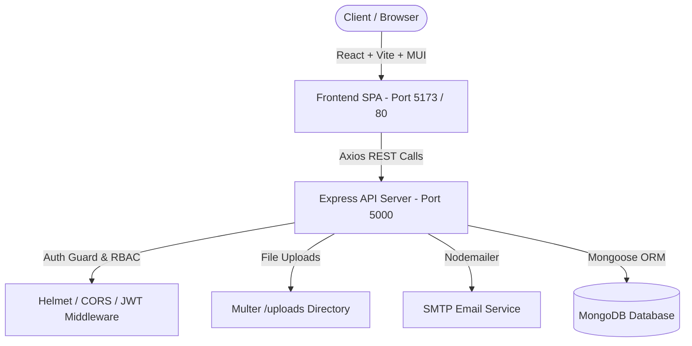

# 🎫 Online Complaint Registration & Management System

A full-stack enterprise **MERN** (MongoDB, Express.js, React.js, Node.js) web application for registering, tracking, communicating, and resolving complaints with **Role-Based Access Control** (RBAC), automated seeder scripts, direct ticket messaging, data export capabilities, file attachments, and complete unit/integration test suites.

---

## 🏗 System Architecture Overview



---

## 👥 Roles & Permissions Matrix

| Capability | USER | AGENT | ADMIN |
| :--- | :---: | :---: | :---: |
| Register & Login | ✅ | ✅ | ✅ |
| Submit New Complaint | ✅ | ❌ | ❌ |
| View Own Submitted Tickets | ✅ | ❌ | ✅ |
| Upload Attachments (Images/PDFs) | ✅ | ❌ | ❌ |
| Direct Messaging / Ticket Chat | ✅ | ✅ | ✅ |
| View Assigned Workload | ❌ | ✅ | ✅ |
| Update Ticket Status & Remarks | ❌ | ✅ | ✅ |
| Submit Resolution Feedback | ✅ (Resolved) | ❌ | ❌ |
| Master Complaints List & Search | ❌ | ❌ | ✅ |
| Assign / Reassign Agent | ❌ | ❌ | ✅ |
| Analytics & Workload Metrics | ❌ | ❌ | ✅ |
| Export Audit Reports (CSV/PDF) | ❌ | ❌ | ✅ |

---

## 📡 REST API Endpoint Documentation

### 🔐 Authentication (`/api/auth`)
| Method | Endpoint | Access | Description |
| :--- | :--- | :--- | :--- |
| `POST` | `/api/auth/register` | Public | Register a new user account |
| `POST` | `/api/auth/login` | Public | Authenticate user & return JWT token |
| `GET` | `/api/auth/me` | Protected | Fetch current user profile |

### 🎫 Complaints (`/api/complaints`)
| Method | Endpoint | Access | Description |
| :--- | :--- | :--- | :--- |
| `POST` | `/api/complaints` | USER | Submit new complaint (supports `multipart/form-data`) |
| `GET` | `/api/complaints/my-complaints` | USER | List complaints submitted by logged-in user |
| `GET` | `/api/complaints/assigned` | AGENT | List complaints assigned to logged-in agent |
| `GET` | `/api/complaints` | ADMIN | Master complaint list with filters & pagination |
| `GET` | `/api/complaints/:id` | Scoped | Fetch full complaint details, stepper, and timeline |
| `PUT` | `/api/complaints/:id/assign` | ADMIN | Assign/reassign agent to ticket |
| `PUT` | `/api/complaints/:id/status` | AGENT / ADMIN | Transition complaint status (*Pending -> In Progress -> Resolved/Rejected*) |

### 💬 Ticket Messaging (`/api/messages`)
| Method | Endpoint | Access | Description |
| :--- | :--- | :--- | :--- |
| `POST` | `/api/messages/:complaintId` | Scoped | Send direct message on complaint ticket thread |
| `GET` | `/api/messages/:complaintId` | Scoped | Fetch chronological chat messages for a complaint |

### ⭐ Feedback (`/api/feedback`)
| Method | Endpoint | Access | Description |
| :--- | :--- | :--- | :--- |
| `POST` | `/api/feedback` | USER | Submit rating & comments for resolved complaint |
| `GET` | `/api/feedback/stats` | ADMIN | View overall user satisfaction metrics |

### 📊 Admin Analytics (`/api/admin`)
| Method | Endpoint | Access | Description |
| :--- | :--- | :--- | :--- |
| `GET` | `/api/admin/analytics` | ADMIN | Fetch status breakdown, category metrics & resolution times |
| `GET` | `/api/admin/agents` | ADMIN | Fetch list of agents and active workload distribution |

---

## 🔑 Seeded Demo Credentials

| Role | Email | Password | Access Scope |
| :--- | :--- | :--- | :--- |
| **ADMIN** | `admin@complaint.com` | `password123` | Master system control, assignment, reports |
| **AGENT (IT)** | `agent.it@complaint.com` | `password123` | IT hardware & software ticket management |
| **AGENT (Maint)** | `agent.maint@complaint.com` | `password123` | Facility & Maintenance ticket management |
| **USER** | `john.doe@example.com` | `password123` | Complaint submission & tracking |

---

## 🚀 Quickstart & Installation

### Option 1: Local Development

#### 1. Install Dependencies
```bash
# Backend dependencies
cd server
npm install

# Frontend dependencies
cd ../client
npm install
```

#### 2. Seed Database
Ensure MongoDB is running locally (`mongodb://localhost:27017/complaint_system`), then run:
```bash
cd server
npm run seed
```

#### 3. Start Development Servers
```bash
# Run both Backend (Port 5000) and Frontend (Port 5173) concurrently from project root
npm run dev
```

---

### Option 2: Docker Containerization Quickstart

Build and orchestrate **MongoDB**, **Express Backend**, and **NGINX Frontend** in one command:

```bash
# Build and run containers in detached mode
docker-compose up --build -d
```

* **Frontend Web App:** `http://localhost:80`
* **Backend API Server:** `http://localhost:5000`
* **MongoDB Instance:** `localhost:27017`

---

## 🧪 Automated Testing

### Backend API Tests (Jest + Supertest + MongoDB Memory Server)
```bash
cd server
npm test
```

### Frontend Component Tests (Vitest + React Testing Library)
```bash
cd client
npm test
```

---

## 🛡 Security & Performance Features

- **JWT Authentication** with Bearer Token middleware.
- **BcryptJS** 10-round salted password hashing.
- **Helmet.js** HTTP header hardening.
- **Rate Limiting** (100 req/15 min IP rate limiter).
- **Gzip Compression** (`compression` middleware).
- **Multer** file validation (strict mime-type filter for images & PDFs, 5MB limit).
- **Mongoose Indexing** on `status`, `creator`, `assignedAgent`, and `createdAt`.
